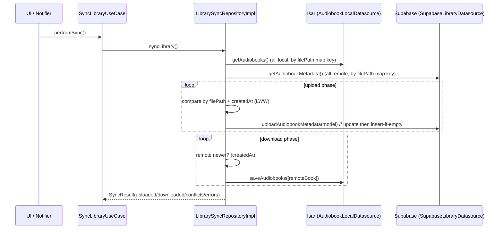

# Flutbook — Data Storage Map & Code Audit

> **Scope:** Reading-only static audit of the `flutbook` Flutter audiobook player (targets: Linux, Android).
> **Tech:** Flutter/Dart, Riverpod, Isar (local), Supabase (remote), just_audio / audio_service / media‑kit.
> **No Flutter/Dart commands were run — every finding is judged purely from source inspection.**

---

## 1. What is stored in the local Isar database

The local database is initialised in `app/flutbook/lib/core/services/database_service.dart`. It opens **9 collections** in the app documents directory:

```dart
Isar.open([
  AudiobookModelSchema,
  AudioEffectModelSchema,
  ......
  UserProfileModelSchema,
], directory: dir.path);
```

### Isar collections table

| # | Collection (model) | File | Purpose | Notable fields |
|---|---|---|---|---|
| 1 | `AudiobookModel` | `features/library/data/models/audiobook_model.dart` | Metadata for each local audiobook file | `id` (autoIncrement), `internalId` (string, maps to domain id / S3‑style key), `title`, `author`, `album`, `coverArtPath`, `durationInMs`, `filePath`, `chapters` (embedded `List<ChapterModel>`), `createdAt`, `lastPlayedAt`, `completed`, `totalSize`, `preferredSpeed` |
| 2 | **(embedded)** `ChapterModel` | same file | Chapter boundaries + per‑file location (multi‑file m4b) | `id`, `title`, `startTimeInMs`, `endTimeInMs`, `filePath` |
| 3 | `LibraryModel` | `features/library/data/models/library_model.dart` | A scanned root folder ("library") | `internalId`, `name`, `path`, `audiobookIds` (`List<String>`), `lastScanAt`, `totalAudiobooks`, `totalDurationInMs` |
| 4 | `PlaybackSessionModel` | `features/player/data/models/playback_session_model.dart` | Per‑audiobook resume position / playback state | `audiobookId`, `currentPositionInMs`, `playbackSpeed`, `isPlaying`, `lastPlayedAt`, `sleepTimerActive`, `sleepTimerDurationInMs` |
| 5 | `PlaybackHistoryModel` | `features/player/data/models/playback_history_model.dart` | Listening history / stats per session | `audiobookId`, `positionInMs`, `durationInMs`, `playedAt` |
| 6 | `BookmarkModel` | `features/player/data/models/bookmark_model.dart` | User bookmarks | `audiobookId` (indexed), `timestamp`, `createdAt`, `note`, `chapterId` (composite index) |
| 7 | `QueueModel` | `features/player/data/models/queue_model.dart` | Saved playback queues/playlists | `name`, `audiobookIds`, `createdAt`, `updatedAt`, `isDefault`, `currentIndex` |
| 8 | `AudioEffectModel` | `features/player/data/models/audio_effect_model.dart` | EQ / bass / treble presets | `domainId`, `name`, `isEnabled`, `bassBoost`, `trebleBoost`, `eqBandsJson`, `presetName`, `createdAt`, `updatedAt` |
| 9 | `QueueItemModel` | `features/sync/data/models/queue_item_model.dart` | Offline sync outbox entry (one per pending operation) | `internalId`, `operationType`, `tableName`, `recordId`, `data` (JSON), `createdAt`, `priority`, `retryCount`, `lastError`, `status` |
| 10 | `UserProfileModel` | `features/auth/data/models/user_profile_model.dart` | Local cache of the signed‑in user | `internalId`, `email`, `displayName`, `authMethod`, `syncEnabled`, `lastSyncAt`, `localLibraryPath` |

> **Note on `QueueItemModel`:** it is registered in Isar and is a genuine collection, but the runtime offline‑queue datasource (`offline_queue_local_ds.dart`) is **in‑memory only** (`_queue = []`) and never touches Isar. So in practice the offline outbox is lost on app restart (see audit issue **A8**).

### ID scheme (important for sync correctness)

The "key" merges auto‑increment `id` (Isar-local, `Id`) with a separate `internalId` String that mirrors the **domain** id. The domain ids themselves are inconsistent across entities:

- `Audiobook` domain id → derived from `filePath` or `internalId` (`audiobook_model.dart:71` `id: internalId ?? filePath`).
- `Bookmark`, `Queue`, `AudioEffect` domain ids → come from **`Id id = Isar.autoIncrement`** (local-only ints), while `AudioEffectModel` *also* carries a separate `domainId` string that is what remote code would need. There is **no remote** for bookmarks/queues/effects today, but the dual-id approach is a landmine (see **A6**).

### Non-Isar local stores

- **SharedPreferences** — `preferences_datasource.dart` (settings/defaults) and Supabase session persistence.
- **JSON file storage** — `json_storage_service.dart` used by `AudiobookLocalDatasource.getSettings/saveSettings`.

---

## 2. What is stored in the Supabase backend

Supabase is used for four things: auth, app tables (Postgres), file backups (Storage), and reading lists. All interactions are in `features/*/data/datasources/remote/` + `features/sync/data/datasources/`.

### 2.1 Postgres tables

```mermaid
erDiagram
    PROFILES ||--o{ AUDIOBOOKS : owns
    PROFILES ||--o{ PLAYBACK_SESSIONS : owns
    PROFILES ||--o{ READING_LISTS : owns
    PROFILES ||--o{ BACKUP_METADATA : owns
    READING_LISTS ||--o{ READING_LIST_ITEMS : has
    AUDIOBOOKS ||--o{ READING_LIST_ITEMS : referenced

    PROFILES {
        uuid id PK "auth.users id"
    }

    AUDIOBOOKS {
        uuid id PK "client internalId"
        uuid user_id FK
        text title
        text author
        text album
        text cover_art_path
        int duration_ms
        text file_path
        timestamp created_at
        timestamp last_played_at
        bool completed
        int total_size
        timestamp updated_at
    }

    PLAYBACK_SESSIONS {
        uuid user_id FK
        text audiobook_id
        int current_position_ms
        float playback_speed
        bool is_playing
        timestamp last_played_at
        bool sleep_timer_active
        int sleep_timer_duration_ms
        timestamp updated_at
    }

    READING_LISTS {
        uuid id PK
        uuid user_id FK
        text name
        text description
        int "order"
        timestamp created_at
        timestamp updated_at
    }

    READING_LIST_ITEMS {
        uuid list_id FK
        text audiobook_id
        timestamp added_at
    }

    BACKUP_METADATA {
        uuid id PK
        uuid user_id FK
        int size
        int item_count
        text type
        text created_at
        text file_path
    }
```

| Table | Written / Read by | Data stored |
|---|---|---|
| `audiobooks` | `supabase_library_sync.dart` | **Metadata only** — title, author, album, cover path, duration, local `file_path`, timestamps, `completed`, `total_size`, `user_id`. Scoped by `user_id`. |
| `playback_sessions` | `supabase_playback_sync.dart` | Resume position, speed, playing flag, sleep timer, timestamps per `audiobook_id`+`user_id`. |
| `reading_lists` | `supabase_reading_list_datasource.dart` | Named lists (name/description/order). |
| `reading_list_items` | `supabase_reading_list_datasource.dart` | Join table linking list → audiobook_id. |
| `backup_metadata` | `supabase_backup_datasource.dart` | Metadata for each backup (size, item count, type, file path in Storage). |

### 2.2 Supabase Storage (bucket `backups`)


- Bucket name: `backups`.
- Files: `user_<user_id>/backup_<backupId>.json.gz`, uploaded with `uploadBinary` (content-type `application/gzip`, `upsert: true`).
- **Important:** the "gzip" is faked — `_compressData`/`_decompressData` just do `utf8.encode`/`utf8.decode` (`supabase_backup_datasource.dart:237-249`). No real compression. The `.gz` extension and `application/gzip` label are misleading.

### 2.3 Auth

Supabase Auth via `supabase_flutter` (`supabase_auth_datasource.dart`): email/password sign in & sign up, Google OAuth, anonymous sign-in, session refresh, logout, `onAuthStateChange` stream. The user profile is *cached* locally in `UserProfileModel` (Isar). *Note:* disconnection between README ("Firebase/Firebase Firestore") and actual code (Supabase) — README is **out of date**.

---

## 3. End-to-end sync flow (local ⇄ Supabase)



---

## 4. Code audit — issues found (static, reading-only)

### CRITICAL

**C1. Unsafe hard cast crashes library sync.** `features/sync/data/repositories/library_sync_repository_impl.dart:62-64`:
```dart
await _remoteDatasource.uploadAudiobookMetadata(localBook as AudiobookModel);
```
`localBook` is a **domain `Audiobook`**, not an `AudiobookModel`. `localBook as AudiobookModel` throws a runtime `TypeError` on the very first *new* local book in the sync upload loop. Line 85 does it correctly with `AudiobookModel.fromDomain(localBook)`. **Fix:** wrap in `AudiobookModel.fromDomain(localBook)` here too (the `_localDatasource.getAudiobooks()` returns domain entities, so the cast is always wrong).

**C2. `serviceRoleKey` is required in the client config — high security risk.** `core/config/app_config.dart:43,51,63` loads `SUPABASE_SERVICE_ROLE_KEY` and immediately throws if it's missing. A Supabase **service-role key bypasses Row Level Security** and must **never** ship inside a client app. It is also currently unused anywhere else, so it should be removed from the client entirely (or at minimum not required/loaded on-device). The `.env.production` etc. files are in `pubspec.yaml` assets — extra care is required that real keys are not committed.

**C3. Backups always contain empty data.** `core/provider/providers.dart:1190-1195` constructs `BackupRepositoryImpl` with hardcoded empty collections:
```dart
return BackupRepositoryImpl(
  backupDatasource: backupDatasource,
  audiobooks: [],
  playbackSessions: [],
  readingLists: [],
);
```
So `createBackup()` serialises an empty dataset. The comment even admits it: *"In a real implementation, these would be fetched from the database"*. Backup for the user is effectively non-functional/empty.

### MAJOR

**M1. `getLastSyncTime()` and `getPendingSyncCount()` are stubs.** Both `LibrarySyncRepositoryImpl` (`:204-218`) and `PlaybackSyncRepositoryImpl` (`:184-188`) return `null`/`0` and mark them `TODO`. The sync UI's `refreshStatus()` and "last synced" display therefore always show `null`/`0`, and no last-sync timestamp is persisted anywhere.

**M2. Library sync compares entire books using `createdAt` as the only version.*` The "last-write-wins" in `library_sync_repository_impl.dart:68-89` compares `createdAt`, which is essentially immutable for a book after import. Edits such as playing progress, `completed`, `preferredSpeed`, or metadata changes are never synced (those fields don't participate in the comparison) — and the remote `uploadAudiobookMetadata` does not send `preferredSpeed` or `chapters` at all (see **M3**). The intended version column is `updated_at` (present on remote) but the code uses `createdAt`. The same class of bug exists in `playback_sync_repository_impl.dart` but there it correctly uses `last_played_at`.

**M3. Remote audiobook round-trip drops `chapters` and `preferredSpeed`.** `getAudiobookMetadata`/`getAudiobookById` rebuild `AudiobookModel` with `chapters: []` (`supabase_library_sync.dart:98,166`) and no `preferredSpeed`. Upload (`:40-53`) also omits `chapters` and `preferredSpeed`. So a "downloaded" remote book loses all chapter navigation and per-book speed. The `internalId`/remote `id` mapping is also fragile.

**M4. Duplicate/dead code proliferation (maintainability + real risk of the wrong one compiling).**
- Two `SyncLibraryUseCase` classes: `features/library/domain/usecases/sync_library_usecase.dart` (10 KB, **unused**) and `features/sync/domain/usecases/sync_library_usecase.dart` (2 KB, used). The large dead copy is confusing and should be deleted.
- `LoginPage`: `features/auth/presentation/pages/login_page.dart` (8 KB) vs `features/auth/presentation/views/login_page.dart` (2.5 KB) vs `features/auth/presentation/login.dart`. Only one is wired into the router; others are dead.
- `ErrorDialog`: `presentation/widgets/error_dialog.dart` vs `shared/widgets/error_dialog.dart`.
- Chapter list: `presentation/widgets/chapter_list.dart` (old, self-referencing import only) vs `features/player/presentation/widgets/chapters_list.dart` (used).
- `app/app.dart` vs `app/view/app.dart` (both imported, but only one is the real root widget).
- `_dev_stubs.dart` defines **duplicate class names** (`LibraryScreen`, `PlaybackScreen`, `SettingsScreen`, `AudiobookModel`) that will collide with real classes if ever imported — a compile-time time bomb.

**M5. Audio effect ID confusion breaks uniqueness.** `AudioEffectModel` stores both Isar `id` (`autoIncrement`) and a `domainId`. The datasource `getAudioEffectByDomainId`/create uses them inconsistently, and `setAudioEffectEnabled`/`update*` operate by Isar int id. With no remote integration, duplication risk + unclear which id is canonical. (Also `AudioEffectModel._mapToJson` hand-rolls JSON — see N5.)

**M6. `audio_initialization_service.dart` failed-initialization state machine is broken.** `initialize()`:
```dart
_catch { _isInitialized = true; _initializationCompleter!.completeError(e, st); }
return _initializationCompleter!.future;
```
After a failure, `_isInitialized` is set `true` and `_initializationCompleter` is **never reset**, so subsequent calls short-circuit to the same failed future. Also there is no `finally` to null the completer on success. The interruption/noisy handlers only `print` and never actually pause/resume playback despite the comments claiming they do (`:101-116`).

**M7. Uber-provider retry logic retries non-transient failures.** `playbackRepositoryProvider`/`bookmarkRepositoryProvider`/etc. loop 3 times with 500 ms delays on *any* error. If the DB failing is fatal, 3 pointless retries delay startup; if it is transient, the loop has no backoff. Also several providers call `ref.watch(...provider)` (sync) on `FutureProvider` results `.value` — e.g. `libraryRemoteDatasourceProvider` (`:568`) and playback remote — which can be `null` while still loading, throwing `Exception('Supabase client not initialized')` spuriously during startup.

### MINOR

**m1. `SupabaseLibraryDatasource.syncAll()` is a placeholder** that only `print`s (`supabase_library_sync.dart:133-141`).

**m2. `_recordConflict` records then immediately auto-resolves silently.** Both sync repos write a `SyncConflict` row and then log `conflictsResolved++` with last-write-wins, so the user is told conflicts were "resolved" even though there is no interactive resolution surface wired up; conflict notification widget exists but the store is never consulted during sync.

**m3. Offline/outbox dual implementation.** A real Isar `QueueItemModel` collection exists **and** an in-memory `OfflineQueueLocalDatasource` exists; they are never connected. Pending ops are silently lost on kill. The `OfflineQueueLocalDatasource()` constructor takes no Isar arg yet the provider awaits a DB-open check then discards it (`providers.dart:1203-1216`).

**m4. `offlineQueueLocalDatasourceProvider` passes nothing usable.** It opens the DB just to validate, then constructs `OfflineQueueLocalDatasource()` with no dependency — all validation is dead weight.

**m5. SharedPreferences/JSON settings split** — `PreferencesDatasource` (SharedPreferences) vs `AudiobookLocalDatasource.getSettings` (JSON file). Two parallel settings stores with no migration, risking divergence.

**m6. `getAudiobookMetadata`'s error on missing remote row in the update-else-insert pattern.** In `uploadAudiobookMetadata` an update with `eq('id', internalId ?? '')` uses the **local internalId** as the remote `id`. If a book was downloaded from another device its remote id is a UUID not present locally → the update matches 0 rows → falls to insert → possibly duplicates. The insert (`data['id'] = internalId ?? ''`) may violate a UUID PK if internalId is a path string.

### NITS / CLEANLINESS

- **N1.** Filename typo: `features/settings/data/datasources/settings._local_ds.dart` (dot before `local`). It is **not imported anywhere** — dead file, delete.
- **N2.** Filename typo: `features/directory_selection/data/datasources/metadat_extractor_ds.dart` ("metadat").
- **N3.** README is outdated: it documents **Firebase / Firestore** and "Web" support, but the code uses **Supabase**, and pubspec supports Android/Linux/iOS/Windows/macOS (no Web). README also lists "Google/Firebase authentication".
- **N4.** `Route`/router wiring references: `app/app.dart` vs `app/view/app.dart` duplication should be consolidated to one.
- **N5.** Hand-rolled JSON for EQ bands (`audio_effect_model.dart:63-85` and `audio_effects_ds.dart:146`) is brittle (values like `3.6kHz` keys, no escaping). Use `jsonEncode`/`jsonDecode`.
- **N6.** A stack of `const`/logic duplicated in `Shared` vs `features` theme folders (`shared/theme/*.dart` vs `core/theme/*.dart`) — two Material 3 theme implementations.
- **N7.** `AudioSession` interruption handled with print-only switches — see M6.
- **N8.** No `@Index()` on most Isar string query columns (only `BookmarkModel` is indexed), so `filePath`/`internalId`/`audiobookId` lookups are full scans (`findAll` + filter in several places, e.g. `playback_local_ds.dart:44`).

---

## 5. Suggested improvement priorities

| Priority | Action |
|---|---|
| P0 | Fix **C1** unsafe cast; remove/neuter **C2** service-role key; fix **C3** empty backups. |
| P1 | Implement real last-sync timestamp + pending count (**M1**); switch library conflict key to `updated_at` and sync `chapters`/`preferredSpeed` (**M2/M3**). |
| P1 | Wire offline outbox to the actual `QueueItemModel` Isar collection (**m3**). |
| P2 | Delete dead/duplicate files (**M4**, **N1**, **N2**, **N6**) and unify the two root `app.dart` files. |
| P2 | Fix init state machine + non-transient retry loops (**M6/M7**). |
| P3 | Update README to match Supabase reality; add indexes; use `json` package for EQ bands; provide real conflict-resolution UI. |

---

*Prepared from a static source read of the repository. Verified findings are annotated with `file:line` references.*
